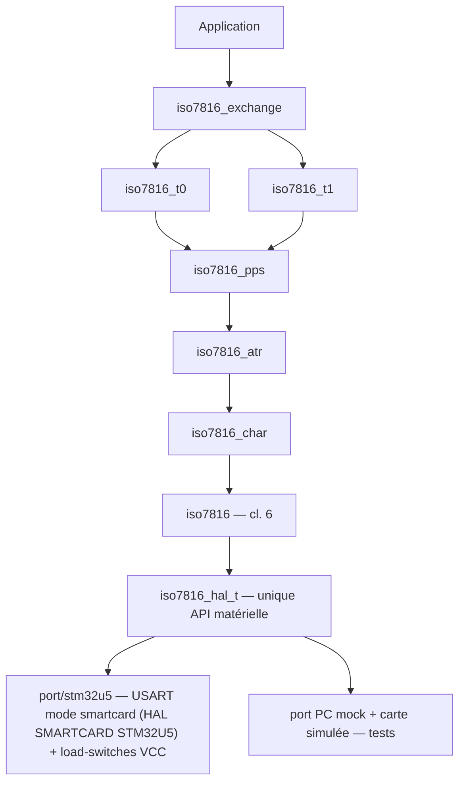

# iso7816 — bibliothèque C (C23) pour l'ISO/IEC 7816-3:2006 côté IFD (lecteur)

Implémente, côté **dispositif d'interface (IFD / terminal)** :
   Couche | Clauses | Module |
 |---|---|---|
 | Procédure carte : classes A/B/C, activation, cold/warm reset, sélection de classe, clock stop, désactivation | 5, 6 | `iso7816.c` |
 | Trame caractère asynchrone : etu = F/D, 10 moments, parité, signal d'erreur + répétition, GT/WT | 7 | `iso7816_char.c` |
 | Answer-to-Reset : TS, T0, bitmap TA/TB/TC/TD, historiques, TCK, TA1 (Fi/Di/fmax), TC1 (N), TA2, T=15 (X, Y) | 8 | `iso7816_atr.c` |
 | PPS (PPSS='FF', PPS0..PPS3, PCK) | 9 | `iso7816_pps.c` |
 | T=0 : header 5 octets, octets de procédure, '61xx'/'6Cxx', GET RESPONSE | 10, 12.2 | `iso7816_t0.c` |
 | T=1 : blocs NAD/PCB/LEN/INF/LRC-CRC, I/R/S, chaînage (M), IFSC/IFSD, CWT/BWT, WTX, IFS, RESYNCH, ABORT, reprise sur erreur | 11, 12.3 | `iso7816_t1.c` |
 | APDU : 7 cas (1, 2S/2E, 3S/3E, 4S/4E) | 12.1 | `iso7816_apdu.c` |

## Architecture



## Conventions de code

- Toute constante de la norme est une **macro** définie dans
  `include/iso7816/iso7816_const.h` (une macro par constante, `ISO7816_<CLASSE>_<NOM>`,
  organisée par clause) — aucun littéral magique dans les sources.
- Les variables de statut (`iso7816_status_t`) contiennent `stat` dans leur nom
  (ex. `stat`, `stat_resp`, `last_stat`) ; le pointeur de contexte est `dev`.

## Documentation API (Doxygen)

La documentation des fonctions exposées est en anglais (commentaires Doxygen
`@brief`/`@param`/`@return` dans `include/iso7816/` et `port/stm32u5/`).

Générer la doc HTML :

```sh
doxygen Doxyfile        # sortie dans docs/html/index.html
```
